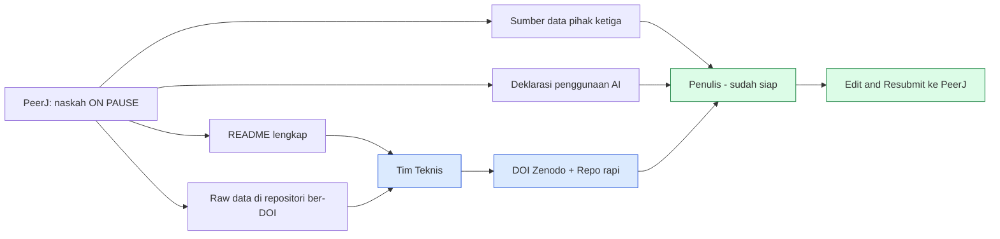
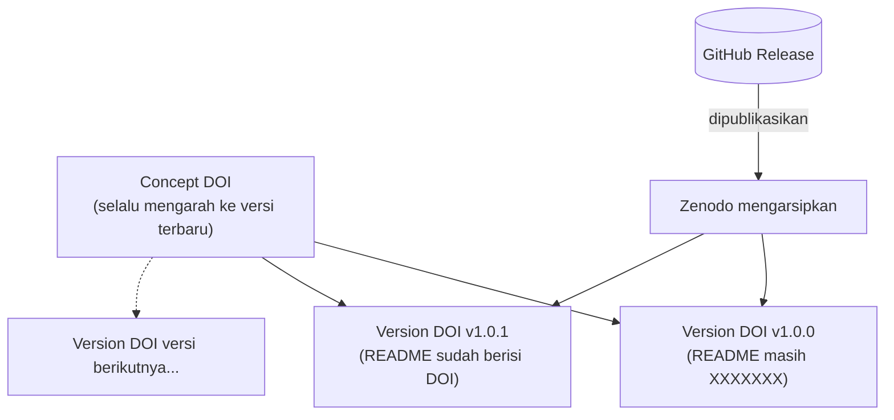
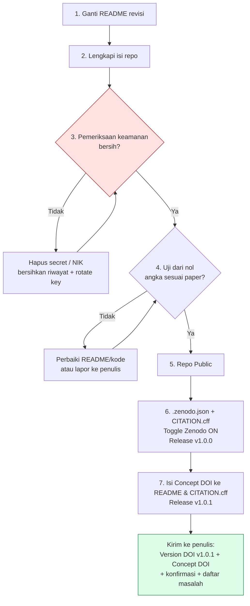
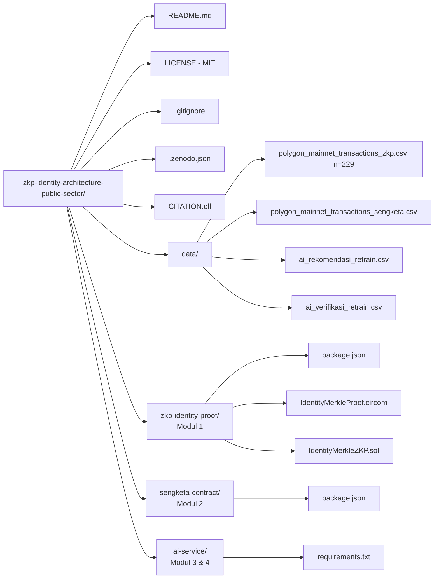
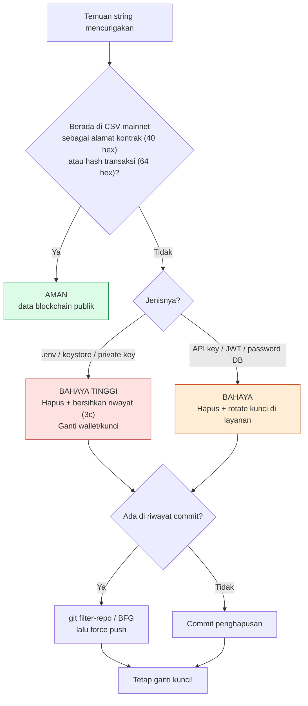
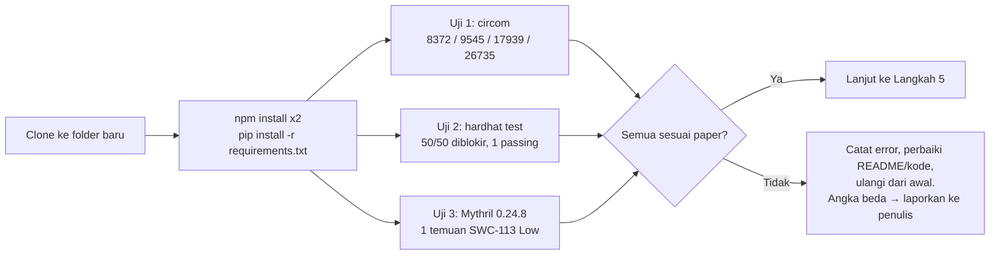
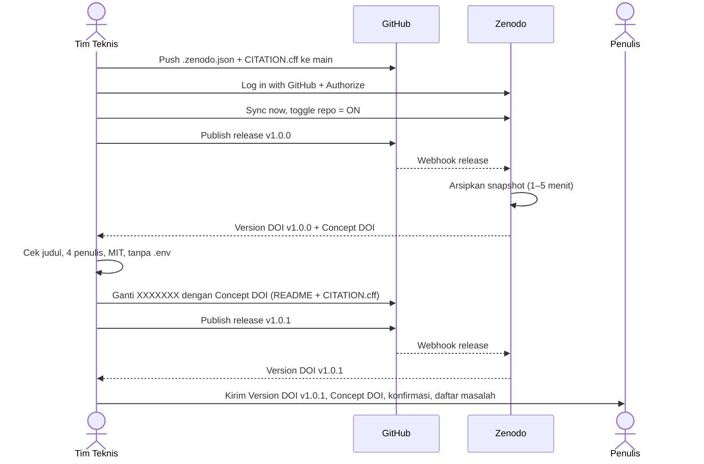
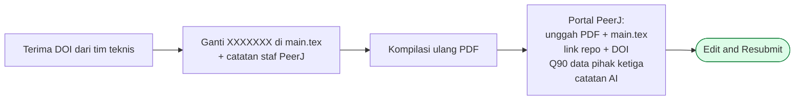

# Panduan Teknis untuk Tim
## Menyiapkan Repositori GitHub dan DOI Zenodo agar Memenuhi Permintaan PeerJ

> **Manuskrip:** *Bytecode Security Auditing and Live Mainnet Validation of a Zero-Knowledge Identity Verification Architecture for Public-Sector Blockchain Platforms*
> **Jurnal:** PeerJ Computer Science
> **Nomor naskah:** `#CS-2026:08:147906`
> **Repositori:** <https://github.com/archyrenaldy-iwu/zkp-identity-architecture-public-sector>

---

## Daftar Isi

1. [Tujuan Dokumen](#1-tujuan-dokumen)
2. [Istilah Penting](#2-istilah-penting-baca-dulu)
3. [Gambaran Urutan Kerja](#3-gambaran-urutan-kerja)
4. [Langkah 1 — Ganti README](#langkah-1--ganti-readme-dengan-versi-revisi)
5. [Langkah 2 — Lengkapi Isi Repo](#langkah-2--lengkapi-isi-repo)
6. [Langkah 3 — Pemeriksaan Keamanan](#langkah-3--pemeriksaan-keamanan-sebelum-dibekukan)
7. [Langkah 4 — Uji Reproduksi dari Nol](#langkah-4--uji-reproduksi-dari-nol)
8. [Langkah 5 — Pastikan Repo Public](#langkah-5--pastikan-repo-berstatus-public)
9. [Langkah 6 — Aktifkan Zenodo & Release v1.0.0](#langkah-6--aktifkan-zenodo-dan-buat-release-v100)
10. [Langkah 7 — DOI ke README & Release v1.0.1](#langkah-7--masukkan-doi-ke-readme-buat-release-v101-lalu-kirim-ke-penulis)
11. [Jika Terjadi Masalah](#4-jika-terjadi-masalah)
12. [Daftar Periksa Akhir](#5-daftar-periksa-akhir)
13. [Yang Dikerjakan Penulis Setelah Menerima DOI](#6-yang-dikerjakan-penulis-setelah-menerima-doi)
14. [Lampiran A — `.zenodo.json`](#lampiran-a-file-zenodojson)
15. [Lampiran B — `CITATION.cff`](#lampiran-b-file-citationcff)
16. [Lampiran C — Contoh `.gitignore`](#lampiran-c-contoh-gitignore)

---

## 1. Tujuan Dokumen

Editor PeerJ **menahan naskah (status *on pause*)** sampai beberapa perbaikan dikirim. Dokumen ini menjelaskan bagian yang dikerjakan **tim teknis**: merapikan repositori GitHub dan membuat **DOI permanen lewat Zenodo**. Setiap langkah dijelaskan: *apa* yang dilakukan, *kenapa* perlu, dan *bagaimana* memastikan hasilnya benar.

### Permintaan PeerJ dan Pembagian Tugas

| Permintaan PeerJ | Artinya | Dikerjakan oleh |
|---|---|---|
| **File README** | Repo harus punya penjelasan: deskripsi, dataset, kode, cara pakai, kebutuhan sistem, metodologi, sitasi, lisensi. | Tim teknis (Langkah 1–2) |
| **Raw data repository** | Google Drive ditolak karena file bisa dihapus/diubah. Data harus ada di repositori permanen yang punya DOI. | Tim teknis (Langkah 3–7) |
| **Third-party data** | Menyebut sumber asli data pihak ketiga di naskah dan di formulir PeerJ. | Penulis (sudah disiapkan) |
| **Penggunaan AI** | Menulis nama, URL, dan versi tool AI di catatan rahasia untuk staf PeerJ. | Penulis (sudah disiapkan) |



---

## 2. Istilah Penting (Baca Dulu)

| Istilah | Penjelasan sederhana |
|---|---|
| **Repositori (repo)** | Folder proyek di GitHub yang menyimpan kode, data, dan riwayat perubahannya. |
| **README** | File `README.md` di halaman depan repo; berfungsi seperti petunjuk penggunaan bagi orang yang baru membuka repo. |
| **Release dan tag** | *Tag* = penanda versi (contoh: `v1.0.0`). *Release* = halaman versi resmi di GitHub yang dibuat dari tag itu. **Zenodo hanya bereaksi saat sebuah release dipublikasikan.** |
| **Zenodo** | Layanan arsip riset gratis dari CERN. Mengambil salinan repo saat release, menyimpannya permanen, dan memberi DOI. |
| **DOI** | Alamat permanen untuk karya ilmiah (contoh: `10.5281/zenodo.1234567`). Link-nya tidak berubah walau repo GitHub diubah atau dihapus. **Inilah yang diminta PeerJ.** |
| **Concept DOI dan Version DOI** | Zenodo memberi dua DOI. *Version DOI* menunjuk satu versi tertentu yang dibekukan. *Concept DOI* menunjuk ke semua versi (selalu mengarah ke yang terbaru). |
| **Secret** | Data rahasia seperti private key wallet, kata sandi, API key (mis. Pinata/IPFS), atau isi file `.env`. **Tidak boleh ada di repo publik.** |

### Visualisasi: Concept DOI vs Version DOI



> [!WARNING]
> **Aturan utama yang harus diingat:** isi repo yang masuk ke Zenodo **tidak bisa ditarik kembali**. Karena itu pemeriksaan keamanan (**Langkah 3**) **wajib selesai sebelum** release dibuat (**Langkah 6**).

---

## 3. Gambaran Urutan Kerja

| No | Langkah | Perkiraan waktu |
|---|---|---|
| 1 | Ganti README dengan versi revisi | 10 menit |
| 2 | Lengkapi isi repo (data, LICENSE, dependensi, `.gitignore`) | 20–30 menit |
| 3 | Pemeriksaan keamanan: cari secret dan data pribadi | 30–60 menit |
| 4 | Uji dari nol: clone repo baru dan jalankan perintah di README | 30–90 menit |
| 5 | Pastikan repo berstatus Public | 2 menit |
| 6 | Aktifkan Zenodo dan buat release v1.0.0 | 15 menit |
| 7 | Tambahkan DOI ke README, buat release v1.0.1, kirim DOI ke penulis | 15 menit |

**Total perkiraan: ± 2 jam 2 menit (minimum) sampai ± 4 jam 2 menit (maksimum).**

### Alur Kerja Keseluruhan



### Estimasi Waktu (Gantt, skenario maksimum)

```mermaid
gantt
    title Estimasi Waktu Pengerjaan (skenario maksimum, menit)
    dateFormat  mm
    axisFormat  %M
    section Persiapan
    L1 Ganti README          :a1, 00, 10m
    L2 Lengkapi isi repo     :a2, after a1, 30m
    section Kritis
    L3 Pemeriksaan keamanan  :crit, a3, after a2, 60m
    L4 Uji dari nol          :crit, a4, after a3, 90m
    section Publikasi
    L5 Repo Public           :a5, after a4, 2m
    L6 Zenodo + v1.0.0       :a6, after a5, 15m
    L7 DOI + v1.0.1          :a7, after a6, 15m
```



---

## LANGKAH 1 — Ganti README dengan Versi Revisi

**Apa:** mengganti file `README.md` di branch `main` dengan file `README.md` yang dilampirkan penulis.

**Kenapa:** PeerJ secara khusus meminta README yang memuat judul, deskripsi, informasi dataset, informasi kode, cara penggunaan, kebutuhan sistem, metodologi, sitasi, serta lisensi. Versi revisi sudah memuat semuanya.

### Cara A — Lewat terminal

```bash
git clone https://github.com/archyrenaldy-iwu/zkp-identity-architecture-public-sector.git
cd zkp-identity-architecture-public-sector
git checkout main
# salin README.md revisi (dari penulis) menimpa file lama, lalu:
git add README.md
git commit -m "Revise README for PeerJ requirements"
git push origin main
```

### Cara B — Lewat situs GitHub

1. Buka repo, klik file `README.md`, klik ikon pensil (**Edit**).
2. Hapus isi lama, tempel isi README revisi, klik **Commit changes**.

> [!TIP]
> **Cara memastikan berhasil:** buka halaman depan repo. Harus terlihat bagian bernomor **1 sampai 10**:
> 1. Title and Description
> 2. Repository Structure
> 3. Dataset Information
> 4. Code Information
> 5. Requirements
> 6. Usage Instructions
> 7. Methodology
> 8. Declaration of Generative AI
> 9. Citation
> 10. License

> [!NOTE]
> **Tulisan `XXXXXXX`:** README revisi masih berisi `10.5281/zenodo.XXXXXXX` (di badge dan sitasi). Itu **memang sengaja** karena DOI belum ada. **Jangan dihapus sekarang** — penggantiannya dilakukan di **Langkah 7**.

---

## LANGKAH 2 — Lengkapi Isi Repo

**Kenapa:** reviewer dan pembaca harus bisa menemukan data dan menjalankan kode. Isi repo juga yang akan dibekukan Zenodo. Periksa daftar berikut satu per satu.

| Item | Harus ada di | Cara cek / tindakan |
|---|---|---|
| **4 file CSV data** | folder `data/` | `polygon_mainnet_transactions_zkp.csv` (n = 229), `polygon_mainnet_transactions_sengketa.csv`, `ai_rekomendasi_retrain.csv`, `ai_verifikasi_retrain.csv`. Jika ada yang hilang, tambahkan. |
| **LICENSE (MIT)** | akar repo | README menyebut lisensi MIT. File `LICENSE` harus ada dan berisi teks MIT lengkap dengan tahun dan nama pemegang hak cipta. |
| **package.json** | `zkp-identity-proof/` dan `sengketa-contract/` | Agar `npm install` bekerja dan versi paket terkunci. |
| **requirements.txt** | `ai-service/` | Daftar pustaka Python beserta versinya. |
| **Circuit utama** | `zkp-identity-proof/` | File `IdentityMerkleProof.circom` dan kontrak `IdentityMerkleZKP.sol` harus ada (dipakai di paper). |
| **.gitignore** | akar repo | Mencegah file besar atau rahasia ikut ter-commit. Contoh isi ada di [Lampiran C](#lampiran-c-contoh-gitignore). |

### Struktur Repo yang Diharapkan



> [!WARNING]
> **Ukuran repo:** Zenodo menerima repo besar, tetapi hindari menyertakan `node_modules/`, folder `.git` raksasa, atau bobot model AI (file ratusan MB). Jika model AI perlu disertakan, simpan di tempat lain dan beri tautan di README.

---

## LANGKAH 3 — Pemeriksaan Keamanan Sebelum Dibekukan

> [!CAUTION]
> **Langkah paling kritis.** Setelah release dibuat, seluruh isi repo tersalin ke Zenodo dan **tidak bisa dihapus sendiri** (hanya bisa lewat permintaan ke tim Zenodo). Jika private key atau API key terlanjur masuk, Anda harus menganggapnya **bocor** dan **menggantinya**.

### 3a. Cari secret di seluruh file dan riwayat commit

Pilih salah satu: alat otomatis **gitleaks** (disarankan) atau pencarian manual.

```bash
# Opsi 1 - gitleaks (otomatis, memeriksa juga riwayat commit)
gitleaks detect --source . --verbose

# Opsi 2 - pencarian manual di file saat ini
git ls-files | grep -iE "\.env|secret|private|keystore|wallet"
git grep -nIiE "private_?key|mnemonic|seed phrase|api_?key|secret|password|PINATA"
```

#### Hal yang harus dicari dan artinya

| Temuan | Bahaya? | Tindakan |
|---|---|---|
| File `.env`, keystore, atau kunci wallet | **YA, sangat berbahaya** | Hapus dari repo **dan dari riwayat** (lihat 3c). Ganti kuncinya. |
| `PINATA_API_KEY`, JWT, kata sandi database | **YA** | Hapus, lalu buat ulang (*rotate*) kunci di layanan terkait. |
| Alamat kontrak (`0x…` 40 karakter), hash transaksi (`0x…` 64 karakter) di CSV mainnet | **TIDAK** | Ini data blockchain publik. Aman. Jangan salah mengira hash transaksi sebagai private key. |
| Private key wallet (64 karakter heksadesimal, biasanya di `.env` atau skrip deploy) | **YA** | Hapus dan ganti wallet jika pernah berisi dana. |

#### Pohon keputusan temuan



### 3b. Pastikan tidak ada data pribadi (NIK)

README menyatakan NIK mentah tidak disimpan di repo. Buktikan dengan mencari deretan 16 digit di file data:

```bash
grep -rnE "[0-9]{16}" data/ | head
```

Jika ada hasil yang berupa **NIK asli**, hapus atau anonimkan sebelum lanjut. Angka 16 digit lain (misalnya ID transaksi) perlu **dicek manual** untuk memastikan itu bukan NIK.

### 3c. Jika secret ditemukan di riwayat commit

Menghapus file di commit terbaru **belum cukup**, karena versi lama masih tersimpan di riwayat. Gunakan `git filter-repo` atau **BFG Repo-Cleaner** untuk membersihkan riwayat, lalu *force push*.

```bash
pip install git-filter-repo
git filter-repo --path .env --invert-paths   # hapus .env dari seluruh riwayat
git push origin main --force
```

> [!IMPORTANT]
> **Tetap ganti kuncinya.** Walau riwayat sudah dibersihkan, anggap kunci yang pernah bocor sudah tidak aman. Buat kunci baru dan nonaktifkan yang lama.

---

## LANGKAH 4 — Uji Reproduksi dari Nol

**Apa:** mengunduh repo ke folder yang benar-benar baru, lalu menjalankan persis perintah yang tertulis di README.

**Kenapa:** reviewer akan melakukan hal yang sama. Jika ada langkah yang gagal, README harus diperbaiki **sebelum dibekukan**.

```bash
cd ~ && mkdir uji-baru && cd uji-baru
git clone https://github.com/archyrenaldy-iwu/zkp-identity-architecture-public-sector.git
cd zkp-identity-architecture-public-sector

# Modul 1 dan 2
cd zkp-identity-proof && npm install && cd ..
cd sengketa-contract && npm install && cd ..

# Modul 3 dan 4
cd ai-service && pip install -r requirements.txt && cd ..
```

### Tiga uji yang menghasilkan angka di paper

| Uji | Perintah (dari folder `zkp-identity-proof`) | Hasil yang harus muncul |
|---|---|---|
| **Kompilasi circuit** | `circom IdentityMerkleProof.circom --r1cs --wasm --sym -l node_modules` | non-linear constraints: **8372**; linear constraints: **9545**; wires: **17939**; labels: **26735** |
| **Simulasi replay attack** | `npx hardhat test` | Total diblokir: **50 dari 50 (100%)**, **1 passing** |
| **Audit bytecode Mythril** | Lihat perintah Docker di bawah | Hanya **1 temuan: SWC-113 severity Low** pada `Groth16Verifier.verifyProof` |

```bash
docker run -v ${PWD}:/tmp mythril/myth:0.24.8 analyze \
  /tmp/IdentityMerkleVerifier.sol /tmp/IdentityMerkleZKP.sol \
  /tmp/IdentityVerifier.sol /tmp/IdentityZKP.sol --execution-timeout 600
```

### Visualisasi alur uji



### Versi alat yang dipakai di paper

| Alat | Versi |
|---|---|
| Circom | 2.1.6 |
| snarkjs | 0.7.3 |
| Mythril | 0.24.8 (image Docker `mythril/myth:0.24.8`) |
| Node.js | 18 atau lebih baru |
| Python | 3.8 sampai 3.10 |

> Gunakan versi yang sama agar hasilnya identik.

Jika ada perintah yang gagal, catat error-nya, perbaiki README (atau kodenya), lalu ulangi uji dari awal. **Angka yang tidak sama dengan paper harus dilaporkan ke penulis sebelum lanjut.**

---

## LANGKAH 5 — Pastikan Repo Berstatus Public

1. Buka repo di GitHub, klik **Settings**, gulir sampai bagian paling bawah (**Danger Zone**).
2. Pastikan tertulis **Public**. Jika masih Private, klik **Change visibility** lalu pilih **Make public**.
3. Buka link repo dari browser lain atau **jendela incognito** (tanpa login). Jika halaman terbuka, berarti sudah publik.

**Kenapa:** Zenodo tidak dapat mengarsipkan repo private, dan reviewer PeerJ tidak bisa membuka link yang private.

---

## LANGKAH 6 — Aktifkan Zenodo dan Buat Release v1.0.0

### 6a. Tambahkan file metadata (disarankan)

Agar halaman Zenodo menampilkan judul dan daftar penulis yang benar, tambahkan dua file di akar repo: **`.zenodo.json`** dan **`CITATION.cff`** (isi ada di [Lampiran A](#lampiran-a-file-zenodojson) dan [Lampiran B](#lampiran-b-file-citationcff)). Commit dan push ke `main` **sebelum** membuat release.

> Jika tidak ditambahkan, Zenodo memakai nama akun GitHub sebagai penulis — dan itu **salah** untuk paper ini.

### 6b. Hubungkan Zenodo dengan GitHub

1. Buka **zenodo.org**, klik **Log in**, pilih **Log in with GitHub**, lalu izinkan akses (**Authorize**).
2. Setelah masuk, klik nama akun di kanan atas, pilih **GitHub** (alamat langsung: `zenodo.org/account/settings/github/`).
3. Klik **Sync now** jika daftar repo belum muncul. Cari `zkp-identity-architecture-public-sector`.
4. Geser tombol (*toggle*) di samping nama repo menjadi **ON**.

> [!CAUTION]
> **Urutan wajib:** toggle harus **ON sebelum** release dibuat. Jika release terlanjur dibuat lebih dulu, Zenodo tidak membuat arsipnya. Solusinya: nyalakan toggle, lalu buat release baru dengan nomor versi berikutnya.

### 6c. Buat release v1.0.0 di GitHub

1. Di halaman repo GitHub, klik **Releases** (kolom kanan), lalu **Create a new release**.
2. Pada **Choose a tag**, ketik `v1.0.0` lalu pilih **Create new tag on publish**. Target: branch `main`.
3. **Release title:** `v1.0.0 - Version submitted to PeerJ Computer Science`.
4. **Deskripsi:** satu kalimat, misalnya *"Code and data supporting the PeerJ manuscript CS-2026:08:147906"*.
5. Klik **Publish release**. **Jangan** pilih *Save draft* atau *pre-release*.

### 6d. Tunggu Zenodo membuat arsip

Dalam **1 sampai 5 menit**, buka kembali halaman GitHub di Zenodo. Repo akan menunjukkan **badge DOI**. Klik badge itu, lalu periksa:

- [ ] Judul sama dengan judul paper.
- [ ] Empat penulis lengkap: **Archy Renaldy Pratama Nugraha, Yandra Arkeman, Irman Hermadi, Yani Nurhadryani**.
- [ ] Lisensi tertulis **MIT**.
- [ ] File arsip berukuran wajar dan **tidak berisi `.env`** atau file rahasia.

Jika metadata salah, klik **Edit** di halaman Zenodo, perbaiki, lalu **Publish**. Catat dua DOI yang tertera:
- **Version DOI** (di kotak *"Digital Object Identifier"*)
- **Concept DOI** (di kotak *"Versions"*)

### Visualisasi interaksi GitHub ↔ Zenodo



---

## LANGKAH 7 — Masukkan DOI ke README, Buat Release v1.0.1, lalu Kirim ke Penulis

**Kenapa ada putaran kedua:** DOI baru diketahui **setelah** release pertama. README dalam arsip v1.0.0 masih berisi `XXXXXXX`. Agar arsip yang dilihat reviewer memuat DOI yang benar, README diperbarui lalu dibuat versi **1.0.1**.

1. Di `README.md`, ganti semua `10.5281/zenodo.XXXXXXX` (di lencana DOI dan di bagian Citation) dengan **Concept DOI** dari Zenodo.
2. Pada `CITATION.cff`, ubah baris `doi:` dengan DOI yang sama.
3. Commit dan push ke `main`.
4. Buat release baru **v1.0.1** (ulangi Langkah 6c).
5. Tunggu arsip selesai, lalu catat **Version DOI milik v1.0.1**.

### Yang harus dikirim balik ke penulis

| No | Item |
|---|---|
| 1 | **Version DOI v1.0.1**, bentuknya `10.5281/zenodo.xxxxxxx` |
| 2 | **Concept DOI** |
| 3 | Konfirmasi bahwa **Langkah 3** (pemeriksaan secret dan NIK) dan **Langkah 4** (uji dari nol) sudah selesai |
| 4 | Daftar masalah atau perbedaan angka, jika ada |

> [!WARNING]
> **Setelah ini jangan mengubah nama.** Jangan mengganti nama akun `archyrenaldy-iwu` atau nama repo. Link GitHub sudah tertulis di manuskrip dan formulir PeerJ.

---

## 4. Jika Terjadi Masalah

| Masalah | Penyebab umum | Solusi |
|---|---|---|
| Repo tidak muncul di daftar Zenodo | Repo private, atau daftar belum diperbarui | Pastikan Public, lalu klik **Sync now**. Tunggu beberapa menit. |
| Release dibuat tapi tidak ada DOI | Toggle belum ON saat release dibuat | Nyalakan toggle, lalu buat release baru (v1.0.1). |
| Penulis di Zenodo salah | `.zenodo.json` atau `CITATION.cff` belum ada | Tambahkan file metadata (Lampiran A, B), atau edit manual di halaman Zenodo, lalu Publish. |
| `npm install` gagal | Versi Node.js tidak cocok | Pakai Node.js 18 atau lebih baru. Periksa `package.json`. |
| `circom: command not found` | Circom belum terpasang | Pasang Circom 2.1.6 sesuai panduan resmi iden3, lalu jalankan ulang. |
| Mythril gagal berjalan | Docker belum aktif | Jalankan Docker Desktop. Gunakan image `mythril/myth:0.24.8`. |
| Angka hasil beda dari paper | Versi alat berbeda, atau data berubah | Samakan versi (tabel di Langkah 4). Jika masih beda, **laporkan ke penulis, jangan mengubah data**. |
| Gitleaks menemukan kunci lama | Kunci pernah ter-commit | Bersihkan riwayat (3c) dan ganti kuncinya. |

---

## 5. Daftar Periksa Akhir

Tandai setiap kotak sebelum mengirim DOI ke penulis.

- [ ] README revisi sudah tampil di halaman depan repo (bagian 1–10 lengkap)
- [ ] Folder `data/` berisi 4 file CSV, `LICENSE` (MIT) ada, `package.json` dan `requirements.txt` ada
- [ ] Pencarian secret (gitleaks atau manual) bersih; tidak ada `.env`, private key, atau API key
- [ ] Tidak ada NIK mentah atau data pribadi di folder `data/`
- [ ] Uji dari nol berhasil; angka sesuai paper (8372 / 9545 constraints, 50 dari 50 diblokir, SWC-113 Low)
- [ ] Repo berstatus Public (dicek lewat jendela incognito)
- [ ] `.zenodo.json` dan `CITATION.cff` sudah ada sebelum release
- [ ] Toggle Zenodo ON, release v1.0.0 sudah dipublikasikan, metadata Zenodo benar (judul, 4 penulis, MIT)
- [ ] README dan `CITATION.cff` sudah berisi Concept DOI; release v1.0.1 sudah dipublikasikan
- [ ] Version DOI v1.0.1 dan Concept DOI sudah dikirim ke penulis

---

## 6. Yang Dikerjakan Penulis Setelah Menerima DOI

1. Mengganti `XXXXXXX` di `main.tex` (bagian *Data Availability*) dan di catatan untuk staf PeerJ.
2. Mengompilasi ulang PDF manuskrip.
3. Di portal PeerJ: mengunggah ulang PDF dan `main.tex`, mengisi link repositori dan DOI, mengisi catatan sumber data pihak ketiga (**pertanyaan 90**), mengisi catatan penggunaan AI untuk staf, lalu menekan **Edit and Resubmit**.



---

## Lampiran A. File `.zenodo.json`

Simpan di akar repo dengan nama persis **`.zenodo.json`** (diawali titik). Jika file ini ada, Zenodo memakainya untuk mengisi metadata.

```json
{
  "title": "Bytecode Security Auditing and Live Mainnet Validation of a Zero-Knowledge Identity Verification Architecture for Public-Sector Blockchain Platforms",
  "upload_type": "software",
  "description": "Code, smart contracts, zero-knowledge circuits, AI services and datasets supporting the PeerJ Computer Science manuscript CS-2026:08:147906.",
  "creators": [
    {"name": "Nugraha, Archy Renaldy Pratama", "affiliation": "IPB University; International Women University"},
    {"name": "Arkeman, Yandra", "affiliation": "IPB University"},
    {"name": "Hermadi, Irman", "affiliation": "IPB University"},
    {"name": "Nurhadryani, Yani", "affiliation": "IPB University"}
  ],
  "license": "MIT",
  "keywords": ["zero-knowledge proofs", "Groth16", "blockchain security",
               "bytecode audit", "decentralized identity", "e-governance"]
}
```

> **Catatan:** penulis dapat menambahkan `"orcid"` pada tiap nama jika tersedia. Pastikan afiliasi tiap penulis sesuai data di manuskrip.

---

## Lampiran B. File `CITATION.cff`

Simpan di akar repo dengan nama **`CITATION.cff`**. GitHub akan menampilkan tombol **"Cite this repository"**.

```yaml
cff-version: 1.2.0
message: "If you use this repository, please cite the associated paper."
title: "Bytecode Security Auditing and Live Mainnet Validation of a Zero-Knowledge
  Identity Verification Architecture for Public-Sector Blockchain Platforms"
authors:
  - family-names: Nugraha
    given-names: Archy Renaldy Pratama
  - family-names: Arkeman
    given-names: Yandra
  - family-names: Hermadi
    given-names: Irman
  - family-names: Nurhadryani
    given-names: Yani
license: MIT
repository-code: "https://github.com/archyrenaldy-iwu/zkp-identity-architecture-public-sector"
doi: 10.5281/zenodo.XXXXXXX  # ganti dengan Concept DOI pada Langkah 7
```

---

## Lampiran C. Contoh `.gitignore`

Cocokkan dengan struktur proyek. Tujuannya mencegah file rahasia dan file besar ikut tersimpan.

```gitignore
node_modules/
.env
.env.*
*.key
*.pem
keystore/
__pycache__/
*.pyc
.venv/
.DS_Store
artifacts/
cache/
*.zkey
*.ptau
```

> **Catatan:** file `*.zkey` dan `*.ptau` (parameter circuit) sering berukuran besar. Jika file tersebut memang **diperlukan untuk reproduksi**, jangan di-ignore; cukup pastikan ukurannya wajar dan jelaskan di README.

---

*Dokumen ini adalah konversi Markdown dari "Panduan Teknis - Repositori GitHub dan DOI Zenodo untuk PeerJ CS-2026:08:147906" (11 halaman). Diagram Mermaid dirender otomatis di GitHub, GitLab, Obsidian, dan VS Code (dengan ekstensi Markdown Preview Mermaid).*